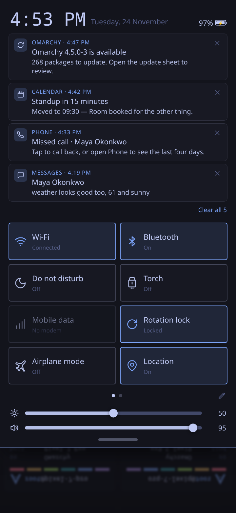
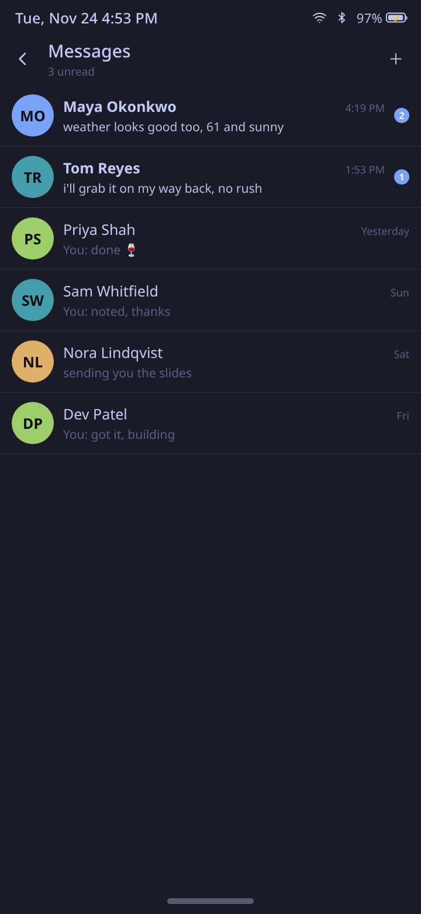

# Omamobile demo

An unofficial, interactive recreation of **[Omamobile](https://github.com/derekross/omamobile)** — the project that runs native Omarchy on phones — as a web app you can install on an Android phone.

It is a phone in a browser tab: the shell, the home screens and widgets, quick settings, the app drawer, the recents switcher, the lock screen and its PIN pad, and a working set of apps. It recolours itself from Omarchy's real theme tokens, and it runs offline once installed.


## What this is, and what it is not

**It is** a faithful, self-contained recreation of Omamobile's phone profile for Omarchy 4.5's shell: a Pixel 7 Pro (`cheetah`, `gs201`) drawn at its own logical resolution of 720×1560, with the shell's elements, gestures and apps rebuilt to be usable rather than merely pictured.

**It is not** Omamobile, Omarchy, Basecamp, or any official anything. Omamobile's phone UI is not a separate app — it is a set of ordinary Omarchy shell plugins plus a phone `shell.json` — and this demo rebuilds those plugins for the browser. Nothing here touches a modem, a camera, a sensor or a kernel. Install the real thing on a real phone to get the real thing.

The demo data is the project's own fictional set from Omamobile's `docs/DEMO.md`: ten made-up people, numbers in the 555-01xx range reserved for fiction, `example.com` addresses, six text threads, nine calls and five notifications. Nothing is real.

## Try it

- **On an Android phone:** open the page, then **Install app** from the browser menu (Chrome, Edge, Brave, Samsung Internet) or **Add to Home Screen** (Safari, Firefox). It gets its own icon and a long-press menu for Messages, Quick settings and Themes; it opens full screen with no browser chrome, and it works with no network.
- **As a window on an Omarchy desktop:** `npm run install-app` adds **Omamobile Demo** to the launcher, and `npm run app` runs it without installing. The window is floated and centred at the Pixel 7 Pro's proportions, sized to fit your display.
- **In a browser tab:** `npm run dev` and open <http://localhost:4173>. On a wide screen there is a side panel with the themes and every shortcut.

<p align="center">
  
  
</p>

### Gestures

| Gesture | What it does |
| --- | --- |
| Swipe down from the top of the home screen | Notifications and quick settings |
| Swipe up on the dock | The app drawer, with search |
| Swipe up (or hold) on the home pill | Recent apps |
| Tap the pill | Home |
| Swipe in from a screen edge | Back |
| Swipe sideways on the home screen | Previous / next home screen |
| Swipe up on the lock screen, or tap it | The PIN pad (any four digits work — nothing is locked) |

### Keys, on a laptop

`←` `→` home screens · `Q` quick settings · `D` app drawer · `R` recent apps · `T` themes · `H` home · `L` lock · `Esc` back · digits and Backspace work on the PIN pad.

### Deep links

Every screen has one, which is handy for screenshots and for linking a specific part of the tour:

`#lock` · `#lock/pin` · `#home/1` · `#shade` · `#drawer` · `#switcher` · `#sheet/theme` · `#sheet/about` · `#app/messages` · `#app/messages/maya` · `#app/phone` · `#app/appearance` · `#app/weather`

## Run it

There is no build step. The site is plain HTML, CSS and ES modules, so any static file server works:

```sh
npm run dev          # node tools/serve.mjs → http://localhost:4173
```

## Publish it for phones

Any HTTPS host will do — a service worker needs a secure origin, and `localhost` counts as one. The repository ships a GitHub Actions workflow that publishes it:

1. Push the repository to GitHub.
2. **Settings → Pages → Source: GitHub Actions**.
3. Push to `main`. The site lands at `https://<user>.github.io/<repo>/` (or a custom domain).

That URL is the install link you send to a phone. Everything is relative — no base path, no build step — so a project subpath works, and so do Netlify, Cloudflare Pages, Vercel or `python3 -m http.server` behind TLS.

What makes it installable on Android, in the order Chrome checks it:

| Requirement | Here |
| --- | --- |
| Served over HTTPS | Any of the hosts above, or `omarchy` + `caddy` locally |
| A linked manifest with `name`, `short_name`, `start_url`, `icons` (192 and 512), `display: standalone` | `manifest.webmanifest` |
| A registered service worker with a fetch handler | `sw.js`, registered on load; precaches the whole shell and uses stale-while-revalidate |
| Maskable icon for the adaptive launcher | `assets/icons/maskable-512.png` |
| Screenshots for the richer install sheet | `assets/screenshots/phone-*.png` (regenerate with `npm run shots:phone`) |

After installing, the icon opens standalone (`display_override` also allows fullscreen), offline, in portrait, with the phone's safe-area insets respected and `theme-color` following the selected theme.

## What is simulated

| Works | Not simulated |
| --- | --- |
| Status bar, home screens, widgets, dock, page dots | The modem: calls, texts and mobile data (sending a text is delivered by a timer) |
| Quick settings: two pages of tiles, brightness, volume, Do Not Disturb | Camera, sensors, fingerprint reader, voice typing |
| Notification shade, heads-up toasts, lock-screen stack | Hyprland, Wayland, and anything below the shell |
| Lock screen, PIN pad, fingerprint shortcut | Waydroid and Android apps |
| Apps: Messages, Phone, Contacts, Camera (a placeholder), Appearance, Settings, Notes, Calendar, Weather, Terminal | Updating Omarchy |
| Every theme, live | — |

## How it is put together

```
index.html            the layers of the phone
manifest.webmanifest  the PWA
sw.js                 precache + stale-while-revalidate
css/                  tokens (theme-derived), stage, shell, lock, apps
js/
  main.js             bootstrap, scale, render pass, gestures, keys, deep links
  store.js            one store, microtask-batched redraws, localStorage
  theme.js            Omarchy colours → CSS variables, procedural wallpapers
  themes.generated.js 17 themes read from colors.toml (generated)
  data.js             the fictional demo dataset
  gestures.js         pointer drags with axis locking, long presses, taps
  icons.js            inline SVG icon set
  home.js apps.js shade.js drawer.js switcher.js lock.js toasts.js sheets.js
  ui.js statusbar.js pill.js util.js
tools/                serve, theme generator, syntax check, screenshots, e2e
```

A few decisions worth knowing about:

- **No framework, no bundler.** A demo of a fast shell should load fast and be readable; ES modules and a 200-line hyperscript are enough. Nothing to install to run it.
- **One store, redraw what changed.** Interactions write to `js/store.js`; a microtask-batched subscription rebuilds the layers. Focus and text selection are captured and restored across redraws so typing survives.
- **Themes are Omarchy's.** `tools/build-themes.mjs` reads `/usr/share/omarchy/themes/*/colors.toml` into CSS custom properties. Every surface is derived from those tokens with `color-mix()`, so a new theme needs no new CSS. The wallpaper is an SVG landscape generated from the same palette.
- **The screen is 720×1560** — half the Pixel 7 Pro's panel — and is scaled to fit. On a handset the frame disappears and the demo fills the display, exactly as the installed app does.

## Tools

```sh
npm run themes       # regenerate js/themes.generated.js from the local Omarchy themes
npm run check        # syntax-check every module; verify the precache list and imports
npm run shots        # render every screen to shots/ with headless Chromium
npm run shots:phone  # the same at 720×1560, phone-only, for the manifest
npm test             # the end-to-end suite (tools/e2e.mjs)
```

`npm test` drives headless Chromium over the DevTools Protocol and checks 55 things a person would notice: unlocking with the PIN pad, opening Messages from the dock and sending a text, tapping the pill, pulling the shade, toggling a tile, picking a theme, swiping up for the drawer, the edge-swipe back, persistence across a reload, landscape rotation, the service worker, and a second pass with **touch** events at handset size — including the tap that raises the PIN pad not also pressing the key underneath it. It needs `chromium` on `PATH` and nothing else.

## Licence

MIT (see `LICENSE`). It is built on ideas and assets from [Omamobile](https://github.com/derekross/omamobile) (MIT) and [Omarchy](https://github.com/basecamp/omarchy) (MIT). Theme colour values come from the Omarchy installation this was generated against. It is not an official Omarchy or Basecamp product, and it is not part of the Omamobile project.
